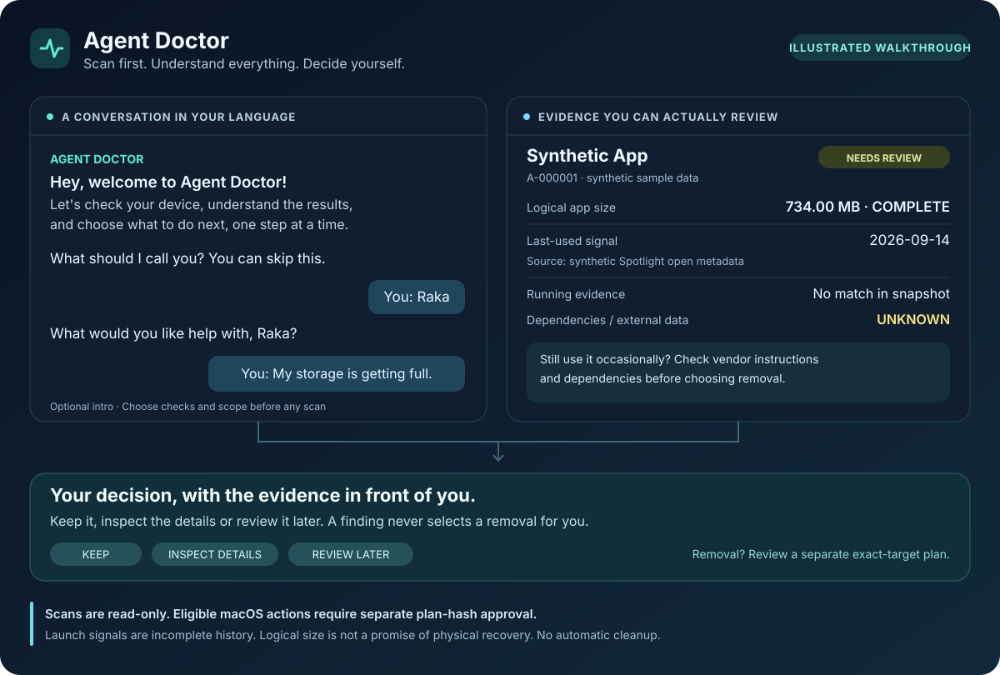
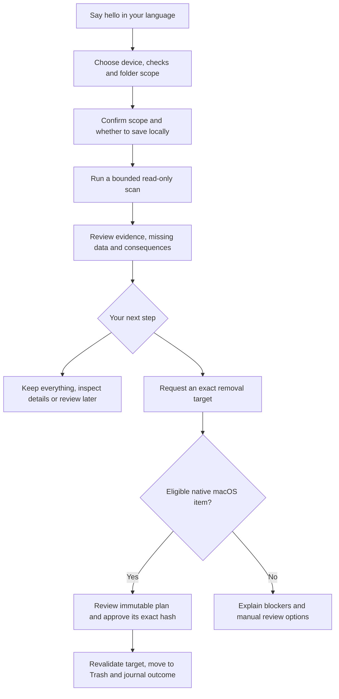

# Agent Doctor For Your Devices

**Scan first. Understand everything. Decide yourself.**

[Take the tour](#a-quick-visual-tour) · [Get started](#build-from-source) ·
[See a report](#what-you-see-before-deciding) · [Use with an agent](#use-with-an-agent) ·
[Delete / uninstall](#experimental-delete-and-uninstall-phase)

A local Go CLI plus an agent skill for investigating device maintenance. It finds
explainable junk candidates, samples performance, inventories applications and groups
exact duplicates. Findings include evidence, uncertainty and manual inspection steps.



*Illustrated chat and report preview, using synthetic data. This is a visual guide,
not a screenshot of a graphical app; Agent Doctor runs in a terminal or an agent chat.*

**Scans remain read-only toward device data.** Version 0.2 adds richer decision
reports and a separate experimental action workflow. On eligible native macOS
items, explicitly approved plans can move one file or one eligible app bundle to
Trash. There is no permanent deletion, process termination or app-data purge.
Reports and review state are written when you choose local storage/export; action
plans and their journals require private local storage. You can keep every item and finish with a
useful report. No telemetry, account or network connection is required by the CLI.

## A quick visual tour



The language-aware chat comes from the [agent skill](#use-with-an-agent).
The standalone CLI provides fixed interactive menus; its current prompts are in
Bahasa Indonesia. Both routes use the same local evidence collectors. Scan consent
and a later action-plan approval are separate decisions.

<details>
<summary><strong>Walk through a first session</strong></summary>

1. Say what you need help with. A nickname and a short description are optional.
2. Choose the device and checks: junk, performance, applications, duplicates or all.
3. For file checks, choose specific folders. Confirm the scope and whether to save
   the report before scanning.
4. Review each finding with its size, available usage evidence and limitations.
   Ask for details, keep it or review it later.
5. If you request a supported removal, review the exact target and consequences in
   a separate plan. Only its explicit hash approval can proceed to native Trash.

Keeping every item is a valid outcome. See [the full action guide](docs/ACTIONS.md)
for eligibility, expiry, recovery and platform limits.

</details>

## Build from source

Install Go 1.26 or newer from [go.dev](https://go.dev/dl/) and Git. No third-party
Go modules, Python, Node or paid API are needed to run the CLI.

macOS / Linux / Crostini terminal:

```sh
git clone https://github.com/RaditteAnggoro/agent-doctor-for-your-devices.git
cd agent-doctor-for-your-devices
go build -trimpath -buildvcs=false -o bin/agent-doctor ./cmd/agent-doctor
./bin/agent-doctor --help
./bin/agent-doctor doctor
```

Windows PowerShell:

```powershell
git clone https://github.com/RaditteAnggoro/agent-doctor-for-your-devices.git
Set-Location agent-doctor-for-your-devices
go build -trimpath -buildvcs=false -o bin/agent-doctor.exe ./cmd/agent-doctor
.\bin\agent-doctor.exe --help
.\bin\agent-doctor.exe doctor
```

The commands below assume `bin` is on your PATH; otherwise use `./bin/agent-doctor`
or `.\bin\agent-doctor.exe`. No published package or prebuilt release is assumed.
The manual release workflow prepares archives only after its test matrix passes.

## Start a review

```sh
agent-doctor scan --interactive
agent-doctor scan --feature duplicates --scope ./my-test-folder --store
agent-doctor scan --all --read-only --scope ./my-test-folder --exclude ./my-test-folder/private --store
agent-doctor scan --feature performance
agent-doctor scan --feature applications
```

Version **0.3.0** starts a fresh interactive CLI session with a friendly greeting,
an optional nickname and an optional description of what you want help with.
Then it asks about the device OS and confirms the detected execution environment.
Noninteractive filesystem scans require explicit roots. `--all` never grants whole-disk
permission. Inspect `doctor` output first; WSL, Crostini, remote and container scans
require `--confirm-environment` to acknowledge their restricted scope. A Linux binary
inside WSL does not measure Windows host health.

A short agent-chat example in English (illustrative; not literal CLI output or a
device scan). The agent follows your conversational language and any preference
you state; you can switch languages as you go.

```text
Agent Doctor: Hey, welcome to Agent Doctor!
              I'll help you check your device, understand the results,
              and choose what to do next. Let's take it one step at a time.
Agent Doctor: What should I call you? You can skip this.
You: Raka
Agent Doctor: What would you like help with? Maybe your device feels slow,
              storage is filling up, or you just want a routine check.
You: My storage is getting full.
Agent Doctor: Got it, Raka. Let's choose your device and what you'd like to check.
```

<details>
<summary><strong>What if I switch languages?</strong></summary>

```text
You: Bisa lanjut pakai bahasa Indonesia? Cek Downloads aja dulu.
Agent Doctor: Bisa, Raka. Kita lanjut pakai bahasa Indonesia.
              Mau cek file kandidat junk, duplikat, atau keduanya di Downloads?
```

The agent keeps your current context and pending choices. It does not restart the
intro or treat a language change as scan or deletion approval. Paths, command flags,
finding IDs and approval hashes stay exactly as recorded. Tool output and JSON retain
their existing format; the agent explains them in your chosen language.

</details>

Both intro questions are optional: press Enter or type `skip`/`lewati`. After that,
use the numbered menu choices or their text aliases; clear `ya`/`yes` answers work
for confirmation. You can type `batal`/`stop` to end the session. This casual wording
does not approve a scan, storage or a deletion plan on your behalf.

Nickname and issue text are used for the current conversation/process and are not
copied into reports, exports, saved scan/review state or a profile. A new CLI process
starts fresh. In an ongoing agent chat, switching features or resuming a review
keeps the existing context without repeating the welcome/name questions. The skill
uses a friendly, informal tone in your language, with aku/kamu when speaking
Indonesian. Technical reports and JSON fields retain their existing structured format.

Without `--store`, the report goes to stdout and no session is saved. Add `--store`
for later review, optionally with `--data-dir <private-folder>`. Saved reports contain
exact paths. Resource defaults are 30 seconds, 10,000 entries, 12 directory levels
and 1 GiB of content reads; configure `--timeout`, `--max-files`, `--max-depth` and
`--max-bytes` for a deliberate deeper scan. Exclusions, protected paths and link/mount
boundaries still apply. Reading files may update access times.

Use the scan ID printed by a saved scan:

```sh
agent-doctor report --scan <scan-id> --summary
agent-doctor inspect D-000001 --scan <scan-id>
agent-doctor explain D-000001 --scan <scan-id>
agent-doctor reveal D-000001 --scan <scan-id>
agent-doctor review D-000001 --scan <scan-id> --decision keep
agent-doctor session list
agent-doctor session resume <scan-id>
agent-doctor export --scan <scan-id> --format markdown --output review.md
agent-doctor export --scan <scan-id> --feature duplicates --format csv --output duplicates.csv
agent-doctor export --scan <scan-id> --format json --share-safe --output shared.json
```

`reveal` prints a containing-folder path for manual navigation and never launches a
file. Review decisions affect session state only. Exports refuse existing destinations.
CSV selects one feature so its fields remain meaningful. `--share-safe` replaces
data-derived strings; inspect remaining counts and sizes before sharing. See
[reporting](docs/REPORTING.md) for formats, review state and exit codes. Synthetic
output examples are in [`examples/`](examples/); their measurements are not device
findings.

## What you see before deciding

| Check | Evidence you can review | A useful next question |
| --- | --- | --- |
| Applications | Logical bundle/package size and completeness, last-used signal and source, running state, role and blockers | Do I still need it, and does the vendor require a dedicated uninstaller? |
| Junk candidates | Exact path, size, modified date, file category and missing usage evidence | Is this still needed for work, restore or offline installation? |
| Duplicates | Every member path, size, dates, exact-content verification and link observations | Which copy must stay available, and is either one referenced or a backup? |
| Performance | CPU sample window, visible process memory, supported system capacity and unknown metrics | Does this match a representative workload, or should I observe longer? |

<details>
<summary><strong>Open a synthetic application report excerpt</strong></summary>

This excerpt comes from the [complete synthetic report](examples/sample-summary.md).
It is sample data, not a diagnosis of your device.

| Field | Example value |
| --- | --- |
| Finding | `A-000001` — Synthetic App |
| Logical app size | 734.00 MB (734003200 bytes), measurement COMPLETED |
| Last-used signal | 2026-09-14; synthetic Spotlight LaunchServices open metadata |
| Running evidence | No matching process in the synthetic snapshot |
| Role | MAIN; not marked as a system app |
| Still unknown | External app data, licenses and actual dependency graph |
| Next step | Inspect the app, check vendor instructions and decide whether to keep or review later |

A launch signal is not complete usage history. No observed process does not mean an
app is unused. Logical size does not promise physically recoverable space.

Open the [Markdown report](examples/sample-summary.md), [structured JSON](examples/sample-findings.json)
or [duplicate CSV](examples/sample-duplicates.csv) to see the formats before running a scan.

</details>

## What is implemented

| Feature | Evidence | Deliberate limits |
| --- | --- | --- |
| Junk | File metadata and old temporary/log/installer files and recognized cache paths | Age/size never proves disuse; sensitive/cloud/managed paths excluded |
| Performance | Two cumulative CPU samples, visible RSS/working set, available system capacity, user startup references | Short observations; metrics vary by OS; no tuning or stopping |
| Applications | Native app/package metadata with source/version where available | Usage/dependencies may be unknown; inventory is read-only and actions are separate |
| Duplicates | Size shortlist, streaming SHA-256, full-content verification and per-member metadata | Exact matches only; no similar-photo matcher or promised physical recovery |

| Platform | Implemented scope | Verification limit |
| --- | --- | --- |
| macOS | Approved filesystem roots, `/Applications`, `/System/Applications` and user app metadata, process samples/capacity, user LaunchAgents filenames | Local macOS checks and CI must be read for the tested revision; all versions/architectures are not certified |
| Windows 10/11 | Approved local roots, registry uninstall metadata, process samples and available memory | Native runtime verification depends on Windows CI; Store/portable apps and startup inventory omitted |
| Linux | Approved roots, available dpkg/rpm/pacman/Flatpak metadata, process samples, `/proc` memory, user startup filenames | Runtime verification depends on Linux CI; distro/package-manager variations remain partial |
| ChromeOS / Crostini | Accessible Linux container and explicitly shared folders only | No ChromeOS hardware verification; host/Android apps, startup and performance unsupported |

Performance and application inventories are **PARTIAL** even when useful: coverage
is intentionally narrower than a full OS inventory. Unknown metrics are null with
reasons. Missing/denied collectors are never reported as a clean bill of health.
[Platform details and manual test plan](docs/PLATFORM_SUPPORT.md).

## Use with an agent

The canonical skill is
[`.agents/skills/agent-doctor-for-your-devices/SKILL.md`](.agents/skills/agent-doctor-for-your-devices/SKILL.md).
Keep its `references/` directory with it. This follows the
[Agent Skills format](https://agentskills.io/specification). Project skill discovery
varies by client/version; read that file explicitly if automatic discovery is absent.
For Codex, a user-local copy can be placed under `~/.codex/skills/`; for Claude Code,
copy the same canonical folder to `.claude/skills/` when supported by the installed
version. Do not maintain divergent copies.

Example prompt: “Use agent-doctor-for-your-devices. I'm on macOS; review duplicates
in this folder, keep everything and explain the results.” The skill confirms the OS,
execution environment and scope before collecting. It handles questions, ambiguity,
postpone and cancel without treating them as permission. Agent clients may have their
own costs and privacy policies. The CLI works independently of any agent client.

## Privacy, limitations and contributing

The CLI makes no network calls and collects no serial numbers or raw process arguments.
Local reports contain private metadata. Do not commit them or attach them to public
issues. Read [privacy](docs/PRIVACY.md), [threat model](docs/THREAT_MODEL.md),
[security reporting](SECURITY.md) and [contributing](CONTRIBUTING.md).

There is no antivirus, registry cleaner, background optimizer or security-audit claim.
Filesystem races, false positives, permissions and short observation windows limit
conclusions. Similar-image detection and permanent deletion remain unavailable. Experimental native Trash actions are described below.

Run `go vet ./...`, `go test -race ./...` and `go build ./cmd/agent-doctor` for local
checks. CI additionally checks formatting and cross-compiles planned architectures.
See [development](docs/DEVELOPMENT.md) and [architecture](docs/ARCHITECTURE.md).

## Inspiration & credits

Created by **RA** as an independent original project. Feature ideas were
inspired by [CleanMyMac](https://macpaw.com/cleanmymac), terminal maintenance workflows
in [Mole](https://github.com/tw93/Mole), duplicate analysis in
[Czkawka](https://github.com/qarmin/czkawka), application review in
[Pearcleaner](https://github.com/hghpublic/alienator88-Pearcleaner), and categorization
in [mac-cleanup-py](https://github.com/mac-cleanup/mac-cleanup-py). There is no affiliation
or endorsement and no upstream implementation code is incorporated.

Original code: [MIT](LICENSE), copyright 2026 RA. Upstream licenses differ;
see [inspiration](docs/INSPIRATION.md), [notices](THIRD_PARTY_NOTICES.md) and [NOTICE.md](NOTICE.md).

## Decision reports in 0.2

Application reports show logical bundle/package size, measurement status and method,
last-used evidence with its source and missing-data reason, running evidence,
system/component role, related-app hints and decision questions. macOS bundle
measurement is bounded; PARTIAL means a lower bound. Spotlight's last-used field is
a LaunchServices open signal, not a complete activity log. No value means unknown.
Windows/Linux retain package-size estimates and explain unavailable usage fields.

Junk reports distinguish modification age from last use and installers from installed
applications. Duplicate reports show every member's exact location, date, size and
link observations, with reference/backup questions. Performance defaults to a 3-second
CPU observation (`--sample-duration 1s..30s`) and adds supported macOS free/compressed
page and swap observations. Free pages alone do not establish memory pressure.

Every finding has review guidance: reasons, missing evidence, questions, action
blockers and next steps. Old stored reports remain readable; new fields absent from
an old scan are displayed as not collected. See [reporting](docs/REPORTING.md).

## Experimental delete and uninstall phase

Use [the action guide](docs/ACTIONS.md). `plan` never changes the selected target;
`apply` requires the exact reviewed plan hash. Plans expire after 15 minutes and
revalidate the saved scan (at most 24 hours old), current target and retained copy.

Native macOS supports single regular-file Trash actions and eligible **bundle-only
uninstall** actions. The latter moves the `.app` to Trash while retaining documents,
preferences, caches, subscriptions and integrations. Running/unknown, system, helper,
related-product and detected integration apps are blocked for vendor/manual review.
Root-owned bundles requiring elevation are also blocked. The user must inspect vendor
instructions before choosing bundle-only removal, consistent with
[Apple's uninstall guidance](https://support.apple.com/102610).

Windows, Linux, WSL, remote sessions and Crostini currently return UNSUPPORTED or a
clear action rejection; their read-only collectors still work within documented limits.
No fallback permanently deletes a target. Local synthetic native Trash/restore tests
are opt-in; standard CI never touches a runner's native Trash. External file writers,
visibility-limited process snapshots and independent action stores remain limits.
